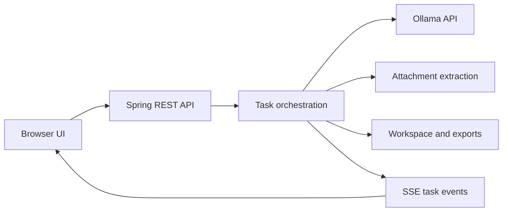

# Local AI Agent

A local-first task runner that gives Ollama language models a structured workflow for multi-step tasks. The app is built with Java 17+, Spring Boot, Maven, and a lightweight browser UI. It can plan a task and execute it one step at a time, or answer directly in chat mode.

> This project orchestrates model requests; it does not give a language model unrestricted tools or run generated shell commands.

## Features

- **Plan and execute:** Ask for a larger task, see the generated plan, and follow step-by-step progress as it streams to the UI.
- **Chat-only mode:** Ask follow-up questions about prior answers or errors without creating an execution plan. Recent user and assistant messages are sent with each request, within a bounded context. Previous turns remain visible in the conversation, including after a page refresh in the same browser tab. Responses stream with formatted headings, lists, tables, inline code, and code blocks. Use **New chat** to clear the conversation.
- **Ollama model controls:** Discover installed models, sort by name or size, load a selected model, inspect loaded models, and offload a model. The selected model stays loaded between requests until you offload it or select another model.
- **Bounded step context:** Each implementation step is a fresh Ollama request. The app passes compact summaries of recent steps and selected workspace files instead of the complete prior conversation.
- **Workspace and file export:** Preview generated files, optionally write them to the configured workspace, save or download individual files, or export generated files as a ZIP. Chat responses can be exported as Markdown, text, or HTML.
- **Attachments:** Include images and supported text or office documents. Image understanding depends on the selected model supporting vision.
- **Thinking control:** The UI shows the thinking option only for models whose Ollama metadata advertises that capability.
- **Live task metrics:** View prompt and generated token counts, processing speeds, model load time, and cumulative Ollama request time.
- **Local controls:** Stop a running task and configure the context size used for model requests.

## Requirements

- Java 17 or later
- Apache Maven 3.9 or later
- [Ollama](https://ollama.com/) running locally
- At least one model pulled into Ollama

Check that Ollama is available and has a model installed:

```powershell
ollama --version
ollama list
```

If you need a model, pull one that fits your machine and task:

```powershell
ollama pull <model-name>
```

Small local models vary significantly in their ability to follow structured instructions and produce complete code. Larger coding models generally work better for multi-file software tasks, provided the computer has enough memory.

## Run locally

Start the Ollama server if it is not already running:

```powershell
ollama serve
```

In another terminal, from the project folder:

```powershell
mvn spring-boot:run
```

Open [http://localhost:8080](http://localhost:8080). The included `start.ps1` launcher runs the Maven app and opens the browser.

To build a runnable package:

```powershell
mvn clean package
java -jar target/local-ai-agent-1.0.0.jar
```

To run the project checks:

```powershell
mvn test
```

## Using the app

1. Wait for the Ollama status to show online. The installed model list refreshes automatically; use the sort button beside the model selector to change its order.
2. Select a model. The app asks Ollama to load it and updates the loaded-model indicator.
3. Choose **Plan & execute steps** for a multi-step task or **Chat only** for a direct response.
4. Optionally attach files or enable thinking when the selected model supports it.
5. Enter the task and start it. In agent mode, the plan appears as execution begins; watch progress and streamed output by step. Use **Stop** to cancel a running task.
6. In agent mode, enable **Allow writing generated files** to write generated files into the workspace. Otherwise, generated files are kept as a preview for the task.
7. Save or download individual results, or use **Export** to download the response or generated files.

In chat mode, continue in the same conversation to ask about an earlier answer. **New chat** starts a fresh conversation. Selecting another model also starts a fresh conversation. Chat history is kept in application memory and in the current browser tab; restarting the application clears the model-side history.

### Attachments

Attachments are limited to 10 MB each. The app accepts PNG, JPEG, WebP, and GIF images, plus TXT, Markdown, CSV, JSON, XML, HTML, JavaScript, Java, Python, CSS, SQL, YAML, DOCX, and XLSX files. Text and office-document content is extracted and added to the task prompt; extracted text is capped at 20,000 characters per file. XLSX extraction currently reads shared strings and the first worksheet. Images are passed to Ollama as image data and require a vision-capable model.

### Workspace behavior

The default workspace is `${user.home}/local-ai-agent-workspace`. You can change it in the UI; the selected path applies until the application restarts. Set `agent.workspace` to change the startup default. The app rejects unsafe relative paths and existing symbolic-link paths when writing task output. The per-file **Save to workspace** action avoids overwriting an existing file by adding a number to the filename, such as `Account1.java`.

## Configuration

Edit `src/main/resources/application.properties` or provide Spring Boot property overrides.

| Property | Default | Description |
| --- | --- | --- |
| `server.address` | `127.0.0.1` | Bind address for the web app |
| `server.port` | `8080` | Web app port |
| `agent.ollama-url` | `http://127.0.0.1:11434` | Ollama server base URL |
| `agent.workspace` | `${user.home}/local-ai-agent-workspace` | Workspace used at startup |

The context-size slider controls the `num_ctx` option sent to Ollama. The model and available system memory determine which context sizes are practical.

By default, prompts and attachments are sent to the Ollama server at `127.0.0.1`. If you change `agent.ollama-url` to a remote server, task content is sent to that server instead.

## API overview

All application routes use the `/api` prefix.

| Method | Route | Purpose |
| --- | --- | --- |
| `GET` | `/models` | List installed Ollama models |
| `GET` | `/models/loaded` | List models currently loaded by Ollama |
| `POST` | `/models/load` | Load a model (`{"model":"model-name"}`) |
| `POST` | `/models/offload` | Unload a model (`{"model":"model-name"}`) |
| `POST` | `/tasks` | Start agent or chat task |
| `GET` | `/tasks/{id}/events` | Stream task events using Server-Sent Events |
| `GET` | `/tasks/{id}` | Read task status |
| `POST` | `/tasks/{id}/stop` | Request task cancellation |
| `GET` | `/tasks/{id}/metrics` | Read Ollama token and duration metrics |
| `GET` | `/tasks/{id}/files` | Read generated files |
| `GET` | `/tasks/{id}/export.zip` | Download generated files as a ZIP |
| `GET` | `/tasks/{id}/response?format={md,txt,html}` | Download a chat response |
| `POST` | `/attachments` | Upload an attachment as multipart form data |
| `GET`, `POST` | `/workspace` | Read or change the workspace path |

Example task request:

```json
{
  "model": "your-installed-model",
  "prompt": "Create a small Spring Boot CRUD API",
  "contextSize": 4096,
  "approveWrites": false,
  "chatOnly": false,
  "think": false,
  "attachmentIds": []
}
```

## Architecture



The Java application is under `src/main/java/com/example/aiagentlocal/dev`, and the static UI is under `src/main/resources/static`. Maven is the only project build system.

## Limitations

- Local language models can return incorrect, incomplete, or poorly formatted results. Structured JSON output improves machine parsing but does not prove that generated code is correct.
- The app validates the response structure and file paths, but does not compile, test, or execute generated code.
- Agent tasks and uploaded attachments are held in memory and are cleared when the server restarts. Workspace files persist on disk.
- Generated files written during agent execution may replace existing files with the same path. Review the preview and use version control or a dedicated workspace.
- The app binds to loopback by default and has no authentication. Do not expose it to an untrusted network without adding appropriate access controls.

## License

No license file is currently included. Add a `LICENSE` file before redistributing this project publicly if you want to grant others explicit reuse rights.
